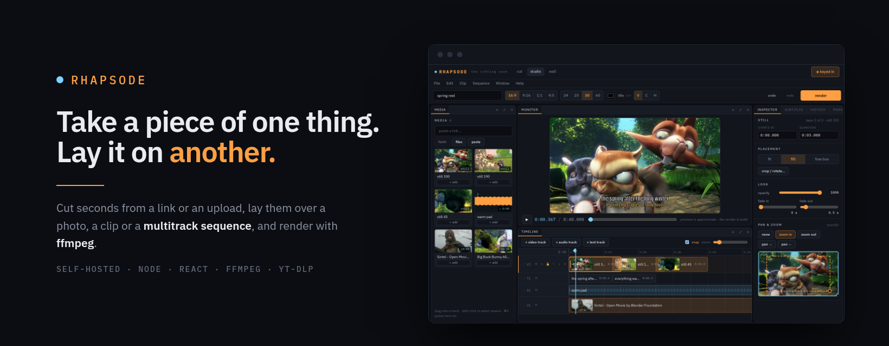
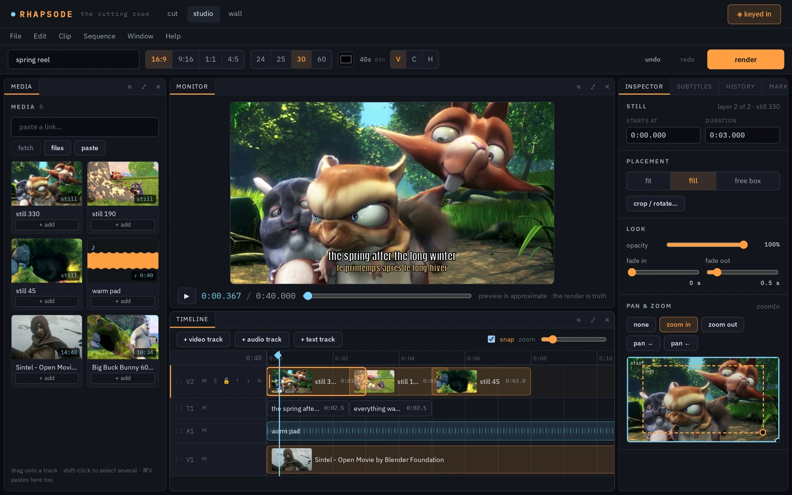
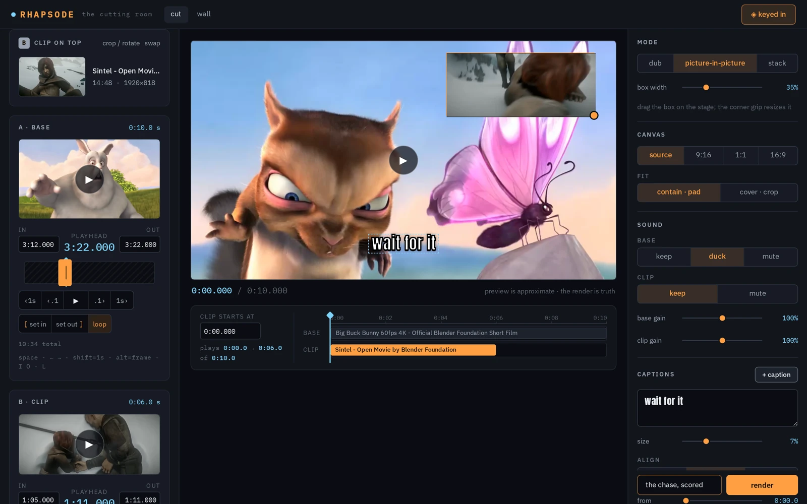
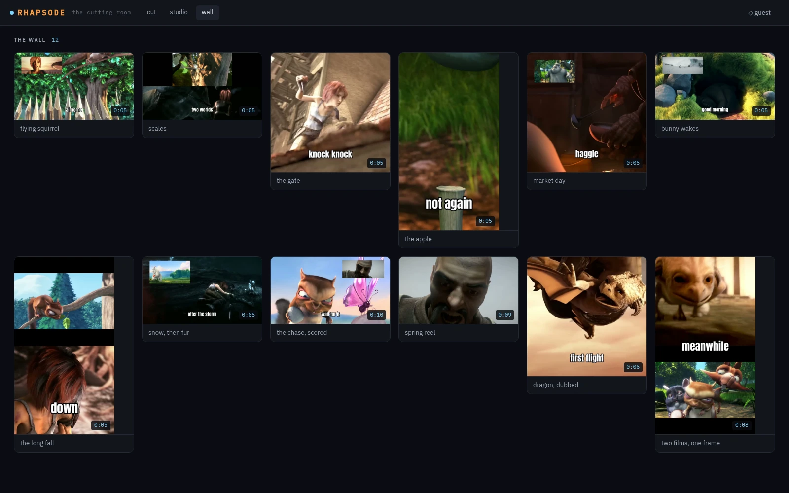
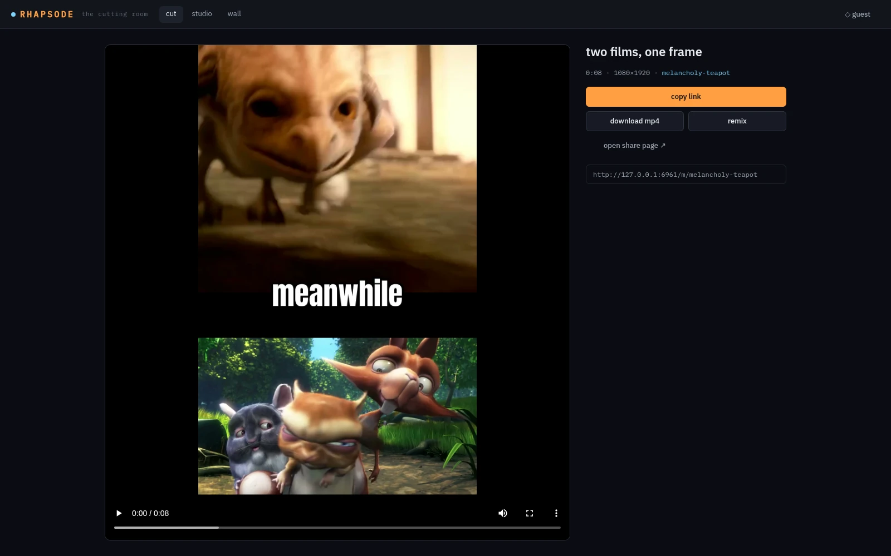

<p align="center"></p>

# Rhapsode

Rhapsode is a self-hosted video editor: cut a few seconds from a link or an upload, lay them over a photo, a clip or a multitrack sequence, render with ffmpeg, and share the result as a short link.

It is for people who make reaction clips, dubs, subtitled excerpts and short montages for a group chat, and want to do it on their own machine: paste a link from any site yt-dlp supports, or drop a file from the phone, and get back an MP4 with a link that plays inline in chat apps. Landing page: <https://zahakj.github.io/rhapsode/>.

<p align="center">
  
  
</p>
<p align="center">
  
  
</p>

<p align="center"><sub>Footage: <i>Big Buck Bunny</i> and <i>Sintel</i>, © Blender Foundation, CC BY.</sub></p>

## Features

- **Sources from anywhere.** A link goes through yt-dlp (best H.264 at or below 1080p); a file can be uploaded, pasted or dropped. For a video longer than 15 minutes you point at a time and only a window around it is fetched.
- **Frame-exact trimming.** Every source gets a browser-friendly proxy cut from the same file as the original, so the in and out points you pick in the browser are the frames that render.
- **Three ways to combine two pieces.** **Dub** puts one clip's sound over the other's picture, with the base's own sound kept, muted or ducked only while the clip has sound; **picture-in-picture** places a box anywhere; **stack** splits the frame top/bottom or left/right.
- **Captions in Latin and Arabic.** Outlined, shadowed or boxed text; a line with Arabic script switches to an Arabic face and is shaped right to left.
- **A multitrack studio.** Up to 12 video, audio and text tracks; stills with pan and zoom; fades and cross-dissolves; free placement, scale, rotation and colour; ripple edits; a one-step photo montage; dockable panels and rebindable shortcuts.
- **Subtitles.** Cues with an optional second line for a translation or a speaker, imported from and exported to SRT.
- **Output for any feed.** 9:16, 1:1, 16:9, 4:5 or the source's own shape, fitted by padding or cropping.
- **Share and remix.** Each render gets a two-word address, `/m/<slug>`, whose OpenGraph tags make it play inline in chat apps. **Remix** reopens the exact document behind any render.
- **Works on a phone.** The cut view becomes a three-step flow on a small screen.
- **Uses the GPU when there is one.** NVENC is detected at boot; otherwise renders use libx264.

## Run

Needs Node 24 or newer, `ffmpeg`/`ffprobe` and `yt-dlp` on `PATH`. For right-to-left captions, ffmpeg must be built with fribidi and harfbuzz.

```sh
git clone https://github.com/ZahakJ/rhapsode && cd rhapsode
npm ci
cp .env.example .env          # set INVITE_KEY (openssl rand -base64 24)
npm run build && npm start    # http://127.0.0.1:8013
```

`curl http://127.0.0.1:8013/healthz` reports the encoder in use and whether yt-dlp was found.

For development, `npm run dev:server` (API on :5950) and `npm run dev` (UI on :5951).
Checks: `npm run typecheck && npm test && npm run build && npm run smoke`.

## Use

Viewing renders is open; adding sources and rendering need the key from `.env`,
entered through the **guest** button in the top bar.

- **Cut** (`#/`): choose a base (video or photo) and a clip to lay on top, from a
  link, a file, a paste or a drop. Trim each with typed in and out points or the
  keyboard (space, ← →, `I`, `O`). Pick a mode: **dub** (the clip's sound over the
  base, with the base kept, ducked or muted), **picture-in-picture**, or **stack**.
  Add captions, choose a canvas, render.
- **Studio** (`#/studio`): video, audio and text tracks; stills with pan and zoom,
  fades, free placement, rotation and colour; subtitles with a second line and SRT
  import and export. Press `?` for the shortcuts.
- **Share**: every render gets a two-word address, `/m/<slug>`, that previews as a
  video in chat apps. **Remix** reopens the recipe behind any render.

Renders of the cut view run up to 3 minutes, studio sequences up to 10.

## Cut from the command line

`rhapsode cut` takes exact pieces out of a link or a file without the web app:
frames at given times, fixed-interval strips, the first frame of each shot, clips
and contact sheets, each run with a `manifest.json` of source, times and hashes.
Links are fetched once, only the needed section, and cached. `rhapsode mcp` offers
the same operations as MCP tools over stdio.

```sh
npm link
rhapsode cut strip 'https://www.youtube.com/watch?v=VIDEO' --from 5:00 --to 5:02 --fps 15 --sheet
rhapsode cut scenes ./match.mp4 --from 10:00 --to 11:00 --size 1280x720
rhapsode cut clip ./match.mp4 --range 10:04-10:09
```

For personal and reference use; follow the terms of the sites you fetch from.
Details in [docs/CUT.md](docs/CUT.md).

## How it works

The browser edits a document: a two-piece recipe or a multitrack sequence, both
zod schemas shared with the server, with every position stored as a fraction of
the canvas so nothing depends on resolution. Each source is stored once as an
original plus a proxy derived from it, so times picked in the browser are exact in
the render. A render job turns the document into a single ffmpeg command through a
pure function whose generated filter graph the tests assert string for string. A
few rules keep that graph honest: output length is an explicit `-t`, never
`-shortest`; every audio lane is padded and mixed without `amix`'s default halving;
a source without sound gets generated silence instead of a missing stream; caption
text is passed through files, so it never needs escaping inside the filter string.
Jobs run in an in-process queue, report progress over Server-Sent Events, and the
finished document is kept with the render, which is what makes remix possible.
Sources nothing references are swept after a week; renders stay until deleted.

## Documentation

- [Architecture](docs/ARCHITECTURE.md): modules, request flow, jobs, HTTP API, security model
- [Data model](docs/DATA-MODEL.md): recipe and sequence schemas, tables, lifetimes
- [Rendering](docs/RENDERING.md): the ffmpeg graphs, fonts, encoders, source proxies
- [Deployment](docs/DEPLOYMENT.md): configuration, systemd, development and tests
- [Cut](docs/CUT.md): the `rhapsode cut` command line and MCP server

## License

[MIT](LICENSE). The bundled fonts (Anton, IBM Plex) are under the SIL Open Font License.
