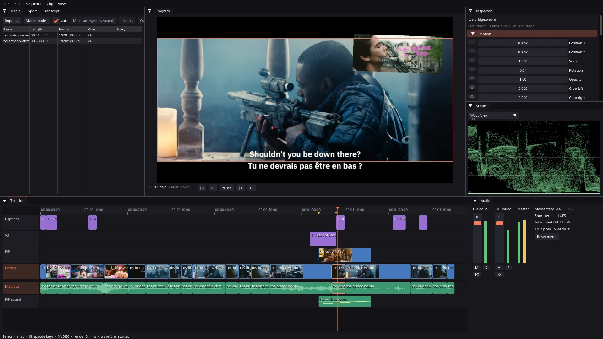

<p align="center"></p>

# Rhapsode

A self-hosted video editor in two parts: a web app that cuts a few seconds from a link and lays them over something else, and a native editor for the whole film.

Landing page: <https://zahakj.github.io/rhapsode/>.

```sh
git clone https://github.com/ZahakJ/rhapsode && cd rhapsode && npm ci && cp .env.example .env && npm run build && npm start
```

That serves the web app on <http://127.0.0.1:8013>. Set `INVITE_KEY` in `.env` first (`openssl rand -base64 24`).

## Quick mode (the browser)

<p align="center">
  
  
</p>

- **Sources from anywhere.** A link goes through yt-dlp (best H.264 at or below 1080p); a file can be uploaded, pasted or dropped. For a video longer than 15 minutes only a window around the moment you point at is fetched.
- **Frame-exact trimming.** The browser scrubs a proxy cut from the same file the render reads, so the frames you pick are the frames that render.
- **Dub, picture-in-picture or stack.** The base's own sound kept, muted, or ducked only while the clip speaks.
- **Captions in Latin and Arabic.** An Arabic line switches face and is shaped right to left.
- **Stems.** Any source splits into vocals and music (Demucs, on the GPU): one video's voice over another's song.
- **A multitrack studio.** Up to 12 video, audio and text tracks, stills with pan and zoom, dissolves, free placement, colour, two-line subtitles, SRT in and out.
- **Share and remix.** Each render gets a two-word address, `/m/<slug>`, that plays inline in chat apps. **Remix** reopens the exact document behind it.
- **Phone and GPU.** The cut view is a three-step flow on a phone; renders use NVENC when there is one, libx264 otherwise.

## Pro (the native editor)

<p align="center"></p>

A non-linear editor in C++20 on FFmpeg 8, Vulkan and Dear ImGui. Everything runs on this machine, the speech and picture models included. Measured on an RTX 4070 SUPER ([docs/BENCHMARKS.md](docs/BENCHMARKS.md)):

- **Real-time 4K.** Three tracks of 4K60 HEVC 10-bit, graded, scaled and rotated, play at 60 fps with no dropped frame in 60 s, and composite at 86 fps unthrottled (Kdenlive's engine: 15.6 fps).
- **Seeks.** 26 ms on all-intra proxies made in the background; 382 ms on long-GOP originals.
- **Timeline.** Unlimited tracks; ripple, roll, slip and slide; nesting; multicam synced by sound; markers; J/K/L; Premiere's keymap or a tighter default.
- **Media.** Frame-exact H.264, HEVC 10-bit, AV1, ProRes and DNxHR on NVDEC; variable-frame-rate phone footage played by its timestamps.
- **Colour.** Linear-light compositing, lift/gamma/gain wheels, curves, `.cube` LUTs, OpenColorIO with ACES 2.0, PQ and HLG output, waveform, parade and vectorscope.
- **Sound.** Keyframed mixer, track EQ, compressor, limiter and gate; a BS.1770-4 loudness meter; normalise to a target; duck music under speech; noise reduction and voice isolation.
- **Local AI.** Transcription at 141× real time (whisper.cpp on CUDA); cut the film by deleting words; captions; silence removal; scene detection; auto-reframe for vertical; background removal.
- **Delivery.** YouTube, social, AV1, HDR10, ProRes and DNxHR presets; 4K HEVC exports at 58 fps on NVENC; a background render queue; smart render that re-encodes only what changed.
- **Interchange.** OTIO, FCPXML, CMX 3600 EDL and Premiere / FCP7 XML, in and out. A quick-mode render opens as a Pro project; a Pro export publishes back as a share link.
- **Projects that do not break.** Checksummed, written atomically, autosaved two seconds after a change; 1000 of 1000 `kill -9` runs recovered.

A 20-minute interview cut to 5 minutes with captions takes 10 steps in Pro, 20 in Premiere's documented workflow.

```sh
cmake -S pro -B pro/build && cmake --build pro/build -j && pro/build/bin/rhapsode-pro
```

Build options, the optional speech and colour libraries and the `rpro` command line are in [pro/README.md](pro/README.md).

## Requirements

- Web app: Node 24 or newer, `ffmpeg`/`ffprobe` and `yt-dlp` on `PATH`. Right-to-left captions need an ffmpeg built with fribidi and harfbuzz; stems need Demucs.
- Pro: Linux with a Vulkan GPU (NVIDIA for NVDEC/NVENC), CMake 3.24, a C++20 compiler, `glslc`, SDL 3.4, FFmpeg 8, FreeType, HarfBuzz, libcurl, nlohmann-json and pugixml.

## Use

Viewing renders is open; adding sources and rendering need the key from `.env`, entered through the **guest** button.

- **Cut** (`#/`): a base and a clip on top, from a link, a file, a paste or a drop. Trim with typed in and out points or the keyboard (space, ← →, `I`, `O`), pick a mode, add captions, render.
- **Studio** (`#/studio`): tracks, motion, colour and subtitles. `?` lists the shortcuts.
- **Pro**: open a project, an OTIO/FCPXML/EDL/XML timeline or media files; `rpro open-web <share link>` turns a quick-mode render into a Pro project.

Cut-view renders run up to 3 minutes, studio sequences up to 10; Pro has no length cap.

For development, `npm run dev:server` (API on :5950) and `npm run dev` (UI on :5951). Checks: `npm run typecheck && npm test && npm run build && npm run smoke`, and `ctest --test-dir pro/build`.

## Cut from the command line

`rhapsode cut` takes exact pieces out of a link or a file without the web app: frames at given times, fixed-interval strips, the first frame of each shot, clips and contact sheets, each with a `manifest.json` of source, times and hashes. `rhapsode mcp` offers the same over MCP.

```sh
npm link
rhapsode cut strip 'https://www.youtube.com/watch?v=VIDEO' --from 5:00 --to 5:02 --fps 15 --sheet
rhapsode cut clip ./match.mp4 --range 10:04-10:09
```

For personal and reference use; follow the terms of the sites you fetch from. Details in [docs/CUT.md](docs/CUT.md).

## How it works

The browser edits a document, a two-piece recipe or a multitrack sequence, shared with the server as zod schemas. A render turns it into one ffmpeg command through a pure function whose filter graph the tests assert string for string; the document is kept with the render, which is what makes remix possible. Pro keeps time in flicks, edits a value-type project with atomic, undoable operations checked by a 100 000-edit property test, and composites on the GPU in linear light.

- [Architecture](docs/ARCHITECTURE.md), [Data model](docs/DATA-MODEL.md), [Rendering](docs/RENDERING.md), [Deployment](docs/DEPLOYMENT.md), [Cut](docs/CUT.md)
- [Pro](pro/README.md), [Benchmarks](docs/BENCHMARKS.md), [Competition](docs/COMPETITION.md)

## License

[MIT](LICENSE). The bundled fonts (Anton, IBM Plex) are under the SIL Open Font License. Footage in the screenshots: *Big Buck Bunny*, *Sintel* and *Tears of Steel*, © Blender Foundation, CC BY.
