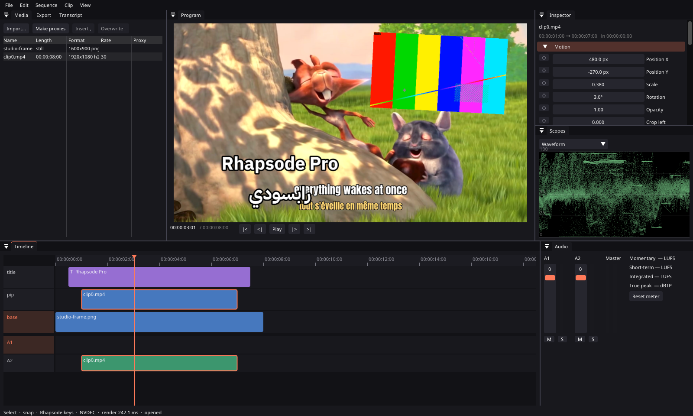

# Rhapsode Pro

The desktop editor beside Rhapsode's quick mode: a native non-linear editor for long, multi-track,
colour- and sound-heavy work. C++20 on FFmpeg 8, SDL3 GPU (Vulkan) and Dear ImGui. Everything runs on
this machine, the speech and picture models included; nothing needs an account or the network.

<p align="center"></p>

## What it does

- **Timeline.** Any number of picture and sound tracks; insert, overwrite, lift, extract, razor, ripple
  delete, close gap; ripple, roll, slip and slide trims; linked picture and sound; sync lock; speed and
  reverse; nested sequences; multicam with angle cuts; markers; dissolves, dips and crossfades; snapping;
  undo for everything. J/K/L shuttle, Premiere's keymap, or Rhapsode's (X razors every track, Backspace
  ripple-deletes, G closes the gap under the playhead).
- **Media.** Frame-exact decode of H.264, HEVC 10-bit, AV1, ProRes and DNxHR, on NVDEC when there is one;
  variable-frame-rate phone footage plays by its real timestamps, no transcode; all-intra proxies made in
  the background; stills, sound files, rotation and non-square pixels.
- **Colour.** Every layer decoded to linear light in the working gamut on the GPU (the stream's own matrix,
  range and transfer); a primary grade with lift, gamma, gain, offset, exposure, contrast, saturation, white
  balance, curves and `.cube` LUTs, on colour wheels; Rec.709, Rec.2020 or ACEScct working space; Rec.709,
  sRGB, PQ and HLG output with HDR material read at its brightness; OpenColorIO with the ACES 2.0 configs
  (any display/view, camera logs as inputs); waveform, RGB parade, vectorscope and histogram.
- **Sound.** A sample-exact mixer with keyframed gain and balance, fades, equal-power crossfades and per
  track EQ, compressor, limiter and gate; a BS.1770-4 meter (momentary, short-term, integrated, range,
  true peak); normalise to a target; duck music under speech; noise reduction and voice isolation rendered
  sample-aligned beside the original.
- **Text and motion.** Titles shaped with HarfBuzz (Arabic joins and runs right to left), outline and box;
  shapes and solids; keyframes with easing on position, scale, rotation, opacity and crop; blur, vignette,
  blend modes.
- **Local AI.** Transcription with word times (whisper.cpp); edit the transcript to cut the film; captions
  from the words, SRT and VTT out, SRT in; silence removal; scene cut detection; auto-reframe for vertical;
  background removal (rembg / U²-Net).
- **Delivery.** Presets for YouTube 1080p and 4K, social vertical and square, AV1, HDR10, ProRes 422 HQ
  and Proxy, DNxHR HQ and HQX; NVENC when present; exports run as their own process in a queue, so an
  export that fails never takes the editor down.
- **Interchange.** OTIO, FCPXML, CMX 3600 EDL and Premiere / FCP7 XML, in and out. A quick-mode render
  opens as a Pro project (its originals download); a Pro export publishes back as a Rhapsode share link.
- **Projects that do not break.** Checksummed JSON written to a temp file, fsynced and renamed, five
  backups kept; autosave two seconds after a change; recovery offered on open.

## Build

Linux with an NVIDIA or any Vulkan GPU. Needs CMake ≥ 3.24, a C++20 compiler, `glslc`, SDL 3.4,
FFmpeg 8 (`libav*`), FreeType, HarfBuzz, libcurl, nlohmann-json and pugixml (all system packages).

```
cmake -S pro -B pro/build
cmake --build pro/build -j2
ctest --test-dir pro/build
pro/build/bin/rhapsode-pro [PROJECT.rpro | TIMELINE.otio | MEDIA...]
```

Speech recognition is optional. Clone whisper.cpp into the build dir and fetch a model:

```
git clone --depth 1 --branch v1.9.5 https://github.com/ggml-org/whisper.cpp pro/build/whisper.cpp
curl -L -o ~/.cache/rhapsode-pro/models/ggml-base.bin \
  https://huggingface.co/ggerganov/whisper.cpp/resolve/main/ggml-base.bin
```

`-DRHAP_WHISPER_CUDA=ON` builds it for the GPU. OpenColorIO is optional the same way: build 2.5 into
`pro/build/ocio` (`-DBUILD_SHARED_LIBS=OFF -DOCIO_INSTALL_EXT_PACKAGES=MISSING`; on GCC 16 its bundled
yaml-cpp needs `#include <cstdint>` in `emitterutils.cpp`) and CMake picks it up. Voice isolation uses Demucs
(`uv tool install demucs --with torch --with torchaudio --with soundfile`), background removal uses
rembg (`uv tool install "rembg[cpu,cli]"`); without them those two menu items say what is missing.

## rpro

The engine without a window: `rpro probe`, `new`, `info`, `export`, `frame`, `loudness`, `transcribe`,
`convert` (between the interchange formats), `open-web`, `publish`, and `bench playback | export`. The
invite key for the web commands comes from `RHAPSODE_KEY`, never from the command line.

## Tests

`ctest` runs the engine suite (doctest), a headless editor test that drives real mouse input through
the UI and checks the saved project, a round trip against a real Rhapsode server, our interchange files
against the OpenTimelineIO reference adapters in both directions (when `pro/build/otio/.venv` has
`opentimelineio otio-cmx3600-adapter otio-fcpx-xml-adapter otio-fcp-adapter`), and every local-AI
feature inside a network namespace with no route out. Some of what they hold the engine to:

- 100 000 random edits never break a timeline invariant, and a refused edit changes nothing
- `kill -9` during editing never leaves an unreadable autosave
- seeks are frame-exact in every codec above, on NVDEC and in software, and VFR plays by timestamp
- decode → GPU composite → Y'CbCr returns the source's own code values; PQ and HLG round trip within
  one 10-bit code
- every export preset is frame-exact across cuts, picture and timestamps both
- the loudness meter matches FFmpeg's `ebur128` within 0.1 LU and reads the EBU −23 dBFS tone as −23.0
- interchange round trips are frame-exact; Premiere XML transitions, FCPXML lanes and EDL dissolves read
- silence edges are found to the sample; deleting words leaves the neighbours a set breath apart

## Shape

`engine/` is the library and has no UI: `model/` (project, edits, undo), `io/`, `media/` (probe, decode,
prefetch), `gfx/` (GPU, colour, text, shaders), `render/` (timeline evaluation, compositor, export),
`audio/`, `interchange/`, `ai/`, `scopes/`, `session/` (playhead, selection, every key as a named
action), `net/`. `app/` is the editor and draws a session; `tools/rpro.cpp` is the CLI. Time is an
integer count of flicks (1/705 600 000 s), which every common frame and sample rate divides exactly.

## License

MIT, like the rest of Rhapsode. Vendored: Dear ImGui, doctest, stb (MIT); see `third_party/README.md`.
